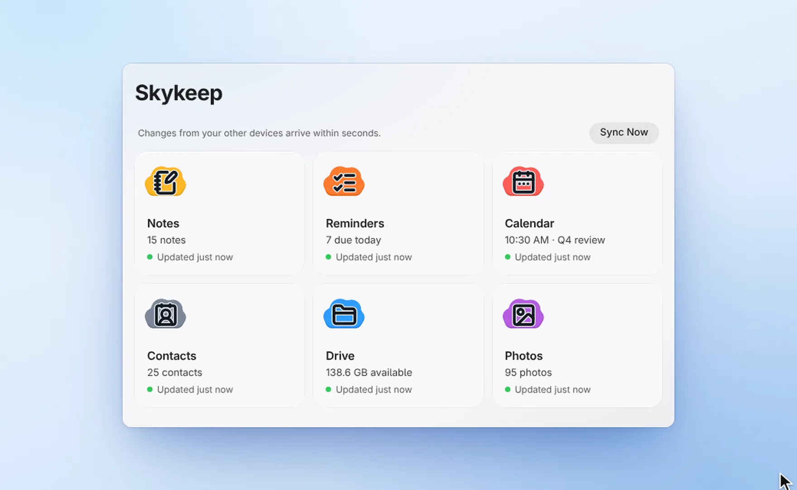
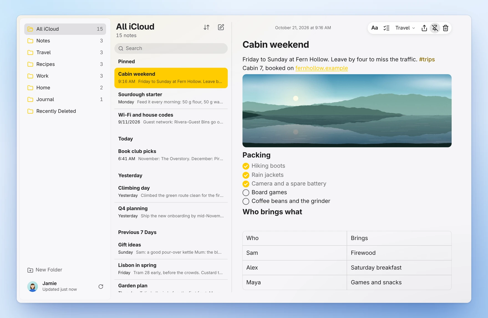
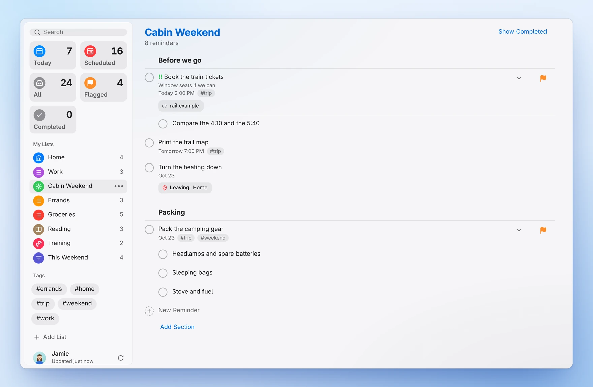
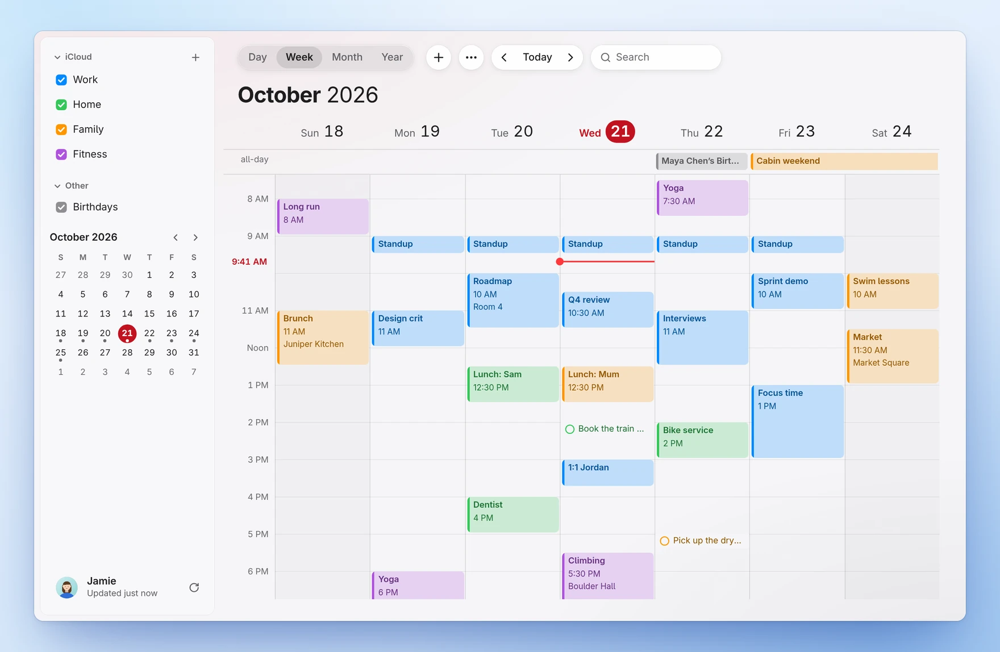
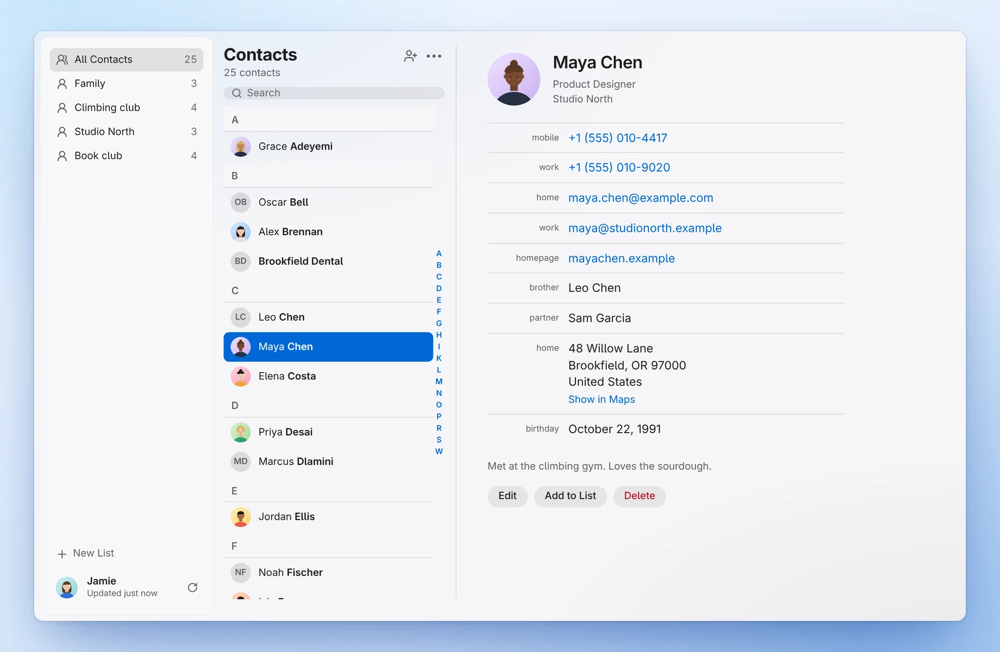
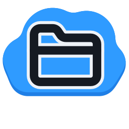
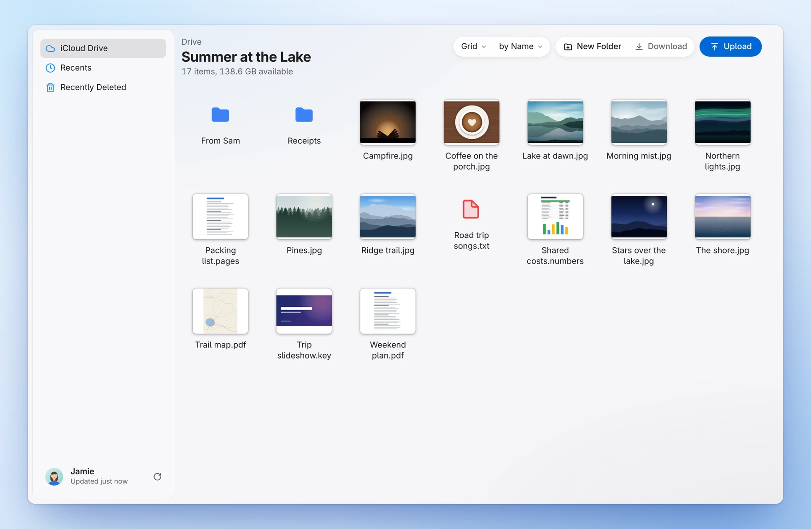
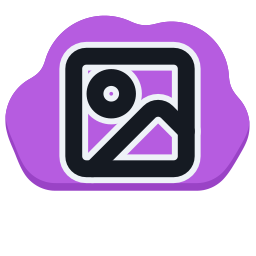
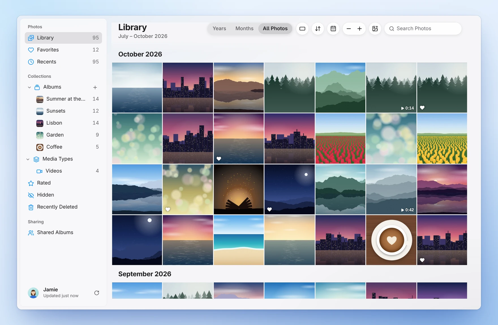

<p align="center">
  
</p>

<h1 align="center">Skykeep</h1>

<p align="center"><strong>Your iPhone's iCloud, on Windows and Linux.</strong><br>Notes, Reminders, Calendar, Contacts, iCloud Drive and Photos as native apps. Send files to your iPhone, back up every photo, and work offline.</p>

<p align="center">
  <a href="https://github.com/YashwanthKamireddi/Skykeep/releases/latest"><strong>Download</strong></a> ·
  <a href="#install">Install</a> ·
  <a href="#engineering">How it works</a> ·
  <a href="#private-by-design">Privacy</a> ·
  <a href=".github/CONTRIBUTING.md">Contribute</a>
</p>

<p align="center">
  <a href="ARCHITECTURE.md"></a>
  <a href="#install"></a>
  <a href="https://github.com/YashwanthKamireddi/Skykeep/releases"></a>
  <a href="https://github.com/YashwanthKamireddi/Skykeep/actions/workflows/ci.yml"></a>
  <a href="https://github.com/YashwanthKamireddi/Skykeep/releases/latest"></a>
  <a href="LICENSE"></a>
</p>

<p align="center"><a href="https://apps.microsoft.com/detail/9P6B042JNK54"></a>&nbsp;&nbsp;<a href="https://snapcraft.io/skykeep"></a></p>

Skykeep keeps your iCloud on your own computer and syncs it quietly in the background. Every app opens instantly, works with no connection at all, and stays in step with your iPhone, iPad and Mac as you use them. Underneath is a small Rust engine that idles at under 0.1% of a CPU core.

<p align="center"><picture><source media="(prefers-color-scheme: dark)" srcset="docs/media/hero-dark.webp"></picture></p>

## Your iCloud, as apps

Open Skykeep and your six apps are right there, each showing what it holds, with your account, backup and settings below them. Each app also has its own icon in your launcher and Start menu, and opens in a window of its own. Click a picture to see it full size.

<table>
  <tr>
    <td width="50%" valign="top"><p align="center"><br><b>Skykeep Notes</b><br><sub>Checklists, tables, drawings and #tags.</sub></p><a href="docs/media/notes-light.webp"><picture><source media="(prefers-color-scheme: dark)" srcset="docs/media/notes-dark.webp"></picture></a></td>
    <td width="50%" valign="top"><p align="center"><br><b>Skykeep Reminders</b><br><sub>Smart lists, subtasks, tags and alerts.</sub></p><a href="docs/media/reminders-light.webp"><picture><source media="(prefers-color-scheme: dark)" srcset="docs/media/reminders-dark.webp"></picture></a></td>
  </tr>
  <tr>
    <td width="50%" valign="top"><p align="center"><br><b>Skykeep Calendar</b><br><sub>Day to year views, drag to edit, time zones. Nextcloud and CalDAV calendars beside iCloud’s.</sub></p><a href="docs/media/calendar-light.webp"><picture><source media="(prefers-color-scheme: dark)" srcset="docs/media/calendar-dark.webp"></picture></a></td>
    <td width="50%" valign="top"><p align="center"><br><b>Skykeep Contacts</b><br><sub>Every field, lists, merging, vCard and CSV.</sub></p><a href="docs/media/contacts-light.webp"><picture><source media="(prefers-color-scheme: dark)" srcset="docs/media/contacts-dark.webp"></picture></a></td>
  </tr>
  <tr>
    <td width="50%" valign="top"><p align="center"><br><b>Skykeep Drive</b><br><sub>Previews, resumable downloads, a real folder.</sub></p><a href="docs/media/drive-light.webp"><picture><source media="(prefers-color-scheme: dark)" srcset="docs/media/drive-dark.webp"></picture></a></td>
    <td width="50%" valign="top"><p align="center"><br><b>Skykeep Photos</b><br><sub>Albums, Shared Library, Live Photos, videos.</sub></p><a href="docs/media/photos-light.webp"><picture><source media="(prefers-color-scheme: dark)" srcset="docs/media/photos-dark.webp"></picture></a></td>
  </tr>
</table>

## Beyond the apps

**Send to iPhone.** Right-click any file on your computer and choose Send to iPhone. Photos and videos appear in your iPhone's Photos, documents in Files, whether the phone is on your desk or on the other side of the world. Nothing to install on the iPhone, nothing to pair.

**Back up iCloud.** Every photo and video you've ever taken, and everything in iCloud Drive, copied as the original to a folder or drive you choose, and kept up to date as you add more. Photos are filed by month; Drive keeps its own folders, and a file changed in iCloud keeps its earlier version in an Earlier versions folder. Unplug the drive and it waits; plug it back in and it carries on. A backup never deletes.

**iCloud in your file manager.** iCloud Drive and Photos are real folders in your file manager, and photos show their thumbnails before anything downloads.

## Engineering

Skykeep is a native engine written in Rust with a light Tauri window on top: one codebase for Linux and Windows, on x86 and ARM.

- Every screen reads a local SQLite library, never the network. Apps open instantly and keep working offline.
- Changes from your iPhone arrive over Apple's own push channel, as they happen.
- Edits go into an outbox: shown the moment you make them, sent in order, held while you're offline, and safe to send twice.
- Notes merge through Apple's own CRDT, so typing on two devices at once keeps both edits.
- Apple's sign-in, SRP with two-factor, is rebuilt in Rust. Your password is never sent.
- The network lock lives in the engine's DNS resolver: it cannot look up a host that isn't Apple's.
- The photo grid stays smooth through 50,000 photos, keeping only what's near the screen in memory.
- iCloud Drive and Photos are real folders in File Explorer, through Cloud Files, the system OneDrive is built on, with Free up space and Always keep on this device. On Linux they're folders in your file manager, through FUSE.
- Each release passes over 1,300 Rust tests and is installed and launched on Ubuntu, Debian, Mint, Fedora, openSUSE, Arch and Windows before it's published.

[ARCHITECTURE.md](ARCHITECTURE.md) has the full tour.

## Private by design

- No Skykeep servers, accounts, analytics or crash reports. Your iCloud goes between your computer and Apple only.
- Add a Nextcloud or CalDAV account and its calendars sit beside iCloud’s. That connection is locked to your own server and goes nowhere else; on Nextcloud you sign in on its own page, so Skykeep never sees your password.
- Your password and session live in the system keyring, the saved connection is encrypted with AES-256-GCM, and your library sits in a folder only you can read.
- The app window can't reach the internet at all; its content policy allows only Skykeep's own engine.
- Every line is open source, and every release is built in public with checksums and signature-checked updates.

[SECURITY.md](SECURITY.md) shows the code behind each point.

## Install

| Platform | Installation |
|---|---|
| **Windows** | [Microsoft Store](https://apps.microsoft.com/detail/9P6B042JNK54), or the [installer](https://github.com/YashwanthKamireddi/Skykeep/releases/latest/download/Skykeep-windows-x64-setup.exe). Also `choco install skykeep` and [Scoop](https://github.com/YashwanthKamireddi/scoop-bucket) |
| **Linux stores** | [Snap Store](https://snapcraft.io/skykeep)<br>Fedora and Fedora Asahi: `sudo dnf copr enable yashonfed/skykeep && sudo dnf install skykeep`<br>Arch: `yay -S skykeep` |
| **Linux files** | [`.deb`](https://github.com/YashwanthKamireddi/Skykeep/releases/latest/download/Skykeep-linux-amd64.deb) ([ARM](https://github.com/YashwanthKamireddi/Skykeep/releases/latest/download/Skykeep-linux-arm64.deb)), [`.rpm`](https://github.com/YashwanthKamireddi/Skykeep/releases/latest/download/Skykeep-linux-x86_64.rpm) ([ARM](https://github.com/YashwanthKamireddi/Skykeep/releases/latest/download/Skykeep-linux-aarch64.rpm)), or the [AppImage](https://github.com/YashwanthKamireddi/Skykeep/releases/latest/download/Skykeep-linux-x86_64.AppImage) for any other Linux |

Every file, with checksums, is on the [latest release](https://github.com/YashwanthKamireddi/Skykeep/releases/latest). The Windows installer, the AppImage and every store keep Skykeep up to date; for a `.deb` or `.rpm`, install the new one over the old.

<details>
<summary>Commands for each Linux file, and fixes for Fedora, openSUSE and the AppImage</summary>

```sh
sudo apt install ./Skykeep-linux-amd64.deb                          # Ubuntu, Debian, Mint
sudo dnf install ./Skykeep-linux-x86_64.rpm                         # Fedora
sudo zypper install --allow-unsigned-rpm ./Skykeep-linux-x86_64.rpm # openSUSE Tumbleweed
chmod +x Skykeep-linux-x86_64.AppImage && ./Skykeep-linux-x86_64.AppImage
sudo snap install skykeep && sudo snap connect skykeep:password-manager-service
```

The Snap's second command lets it keep you signed in through your keyring. On Ubuntu the AppImage needs `libfuse2t64` once (`libfuse2` on 22.04). Fedora and openSUSE leave out the decoder for iPhone photos (HEIC) for patent reasons: on Fedora, enable RPM Fusion and `sudo dnf install libheif-freeworld`; on openSUSE, add Packman and install `libheif1`. For Drive and Photos as folders on Arch, also `sudo pacman -S fuse3`.
</details>

## Official downloads

Skykeep is published only through the links above: GitHub Releases, the Microsoft Store, the Snap Store, Chocolatey, the [Scoop bucket](https://github.com/YashwanthKamireddi/scoop-bucket) and the COPR `yashonfed/skykeep`. The AUR packages `skykeep` and `skykeep-bin` are kept by a community packager and built from these releases. Flathub and winget join this list once they are live. On Android, the APK will be on GitHub Releases. Its signing-certificate SHA-256 fingerprint: to be published with the first Android release, so you can check the copy you install.

A copy from anywhere else is not from this project. Never type your Apple Account password into one you can't trace back here.

## Sign in

1. Open Skykeep and sign in with your Apple Account.
2. Approve the sign-in on your iPhone, iPad or Mac, as you would for icloud.com.
3. Your library arrives, and each app fills in as it lands. From then on everything opens from your computer.

Using Advanced Data Protection? Turn on **Access iCloud Data on the Web** first (iPhone: Settings, your name, iCloud). Calendar and Contacts then open right away, and Notes, Reminders, Photos and iCloud Drive sync once you approve Skykeep on your iPhone.

## Questions

<details>
<summary>How do I use iCloud and Apple Notes on Linux?</summary>

Install Skykeep (see [Install](#install)) and sign in with your Apple Account. Apple makes no iCloud app for Linux; Skykeep gives you Notes, Reminders, Calendar, Contacts, iCloud Drive and Photos as native apps there, kept on your computer and in sync with your iPhone. iCloud Drive and Photos also appear as folders in your file manager.
</details>

<details>
<summary>Can I use Apple Notes and Reminders on Windows?</summary>

Yes. Apple's own iCloud for Windows has no Notes or Reminders app; Skykeep has both, with checklists, tables, smart lists and alerts, alongside Calendar, Contacts, iCloud Drive and Photos. Get it from the Microsoft Store, Chocolatey, Scoop or the installer on the [releases page](https://github.com/YashwanthKamireddi/Skykeep/releases/latest).
</details>

<details>
<summary>Is Skykeep made by Apple?</summary>

No. It's an independent, open-source app that works with iCloud. Apple, iCloud and iPhone are trademarks of Apple Inc.
</details>

<details>
<summary>How is this different from iCloud for Windows?</summary>

iCloud for Windows brings Photos and iCloud Drive to File Explorer, and Calendar and Contacts through Outlook. Skykeep has Notes and Reminders too, all six as apps of their own in your launcher, works offline, and runs on Linux as well.
</details>

<details>
<summary>Why does it need my Apple Account password?</summary>

Notes, Reminders, Drive and Photos open only to a full sign-in with two-factor, the same one icloud.com uses. Skykeep proves your password to Apple with SRP rather than sending it, and keeps it in your system keyring so it can sign back in by itself. Like any keyring entry, programs running as you can read it, and signing out erases it.
</details>

<details>
<summary>Is it safe to use with my Apple Account?</summary>

Skykeep signs in the same way icloud.com does, with your password and two-factor code, and your iCloud goes only between your computer and Apple. Besides Apple, it connects only to the calendars you subscribe to, the Nextcloud or CalDAV accounts you add, and, in a copy from the Windows installer (Chocolatey's too), the `.msi` or the AppImage, GitHub's release servers to check for new versions of Skykeep. Settings, under What Skykeep Talks To, lists every address your copy can reach.

It is not an Apple-approved app: Apple offers no official way for other apps to reach Notes, Reminders, Drive or Photos, so Skykeep uses the same web services icloud.com uses, as long-standing open-source tools like icloudpd do. Apple can change those services at any time, and may now and then ask you to sign in again or approve on your iPhone. Apple's iCloud terms are between you and Apple. Skykeep has no servers of its own and its code is public, so you can check exactly what it sends and where.
</details>

<details>
<summary>How do I send a diagnostics log?</summary>

Quit Skykeep and start it with `SKYKEEP_LOG=1 skykeep` (Windows PowerShell: `$env:SKYKEEP_LOG=1`, then `skykeep.exe`). It writes `diagnostics.log` in its data folder with the addresses it asked and Apple's answer codes, never passwords, tokens or anything from your library. Attach it to a [bug report](https://github.com/YashwanthKamireddi/Skykeep/issues/new?template=bug_report.yml).
</details>

## Contributing

Bug reports, packaging for your distro, design ideas and code are all welcome. [CONTRIBUTING.md](.github/CONTRIBUTING.md) has the setup and a map of the code, and [Discussions](https://github.com/YashwanthKamireddi/Skykeep/discussions) is the place for questions and ideas. Security problems go to a [private report](https://github.com/YashwanthKamireddi/Skykeep/security/advisories/new).

## Name and logo

The GPL-3.0 covers Skykeep's code, not its name or logo. As section 7(e) of the licence allows, it grants no rights to use them: a changed version you share with others needs a name and icon of its own, so nobody mistakes it for this project. Saying that your version is based on Skykeep is fine.

Copyright (C) 2026 Yashwanth Kamireddi. [GPL-3.0](LICENSE): if you share a copy or a changed version, keep this notice and the same licence. It comes with no warranty. Not affiliated with or endorsed by Apple Inc. Apple, iCloud and iPhone are trademarks of Apple Inc., registered in the U.S. and other countries and regions.
